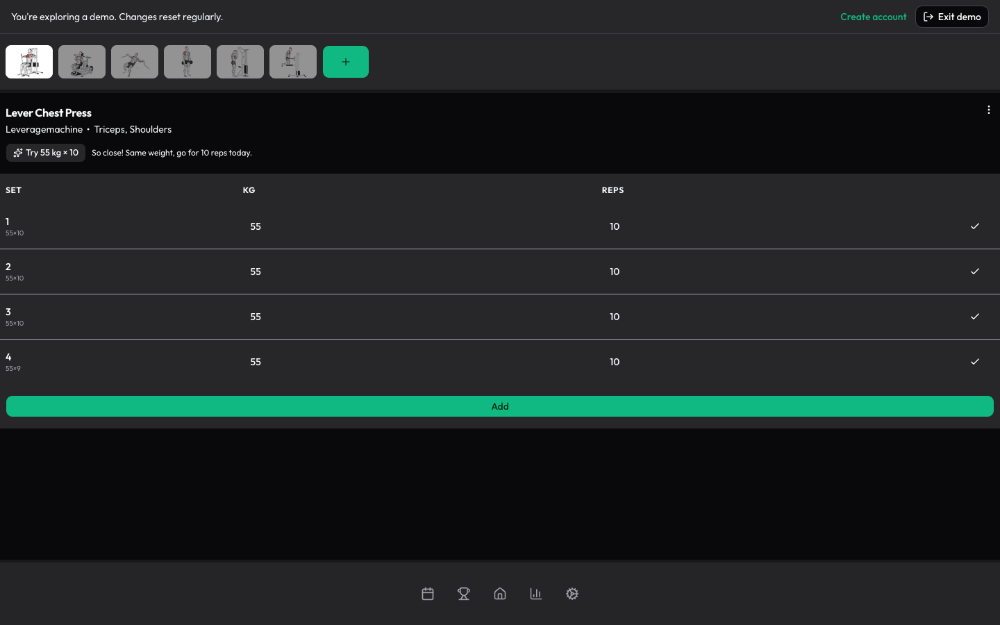
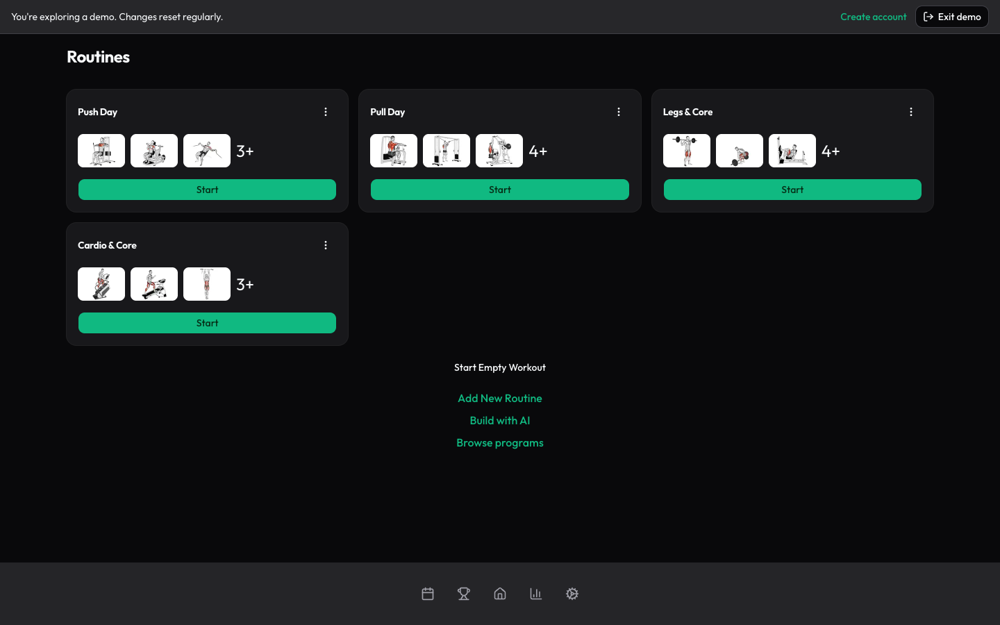
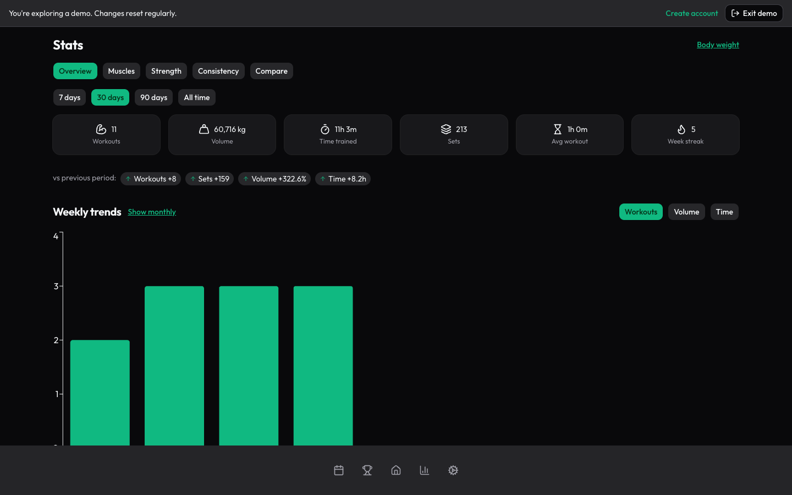
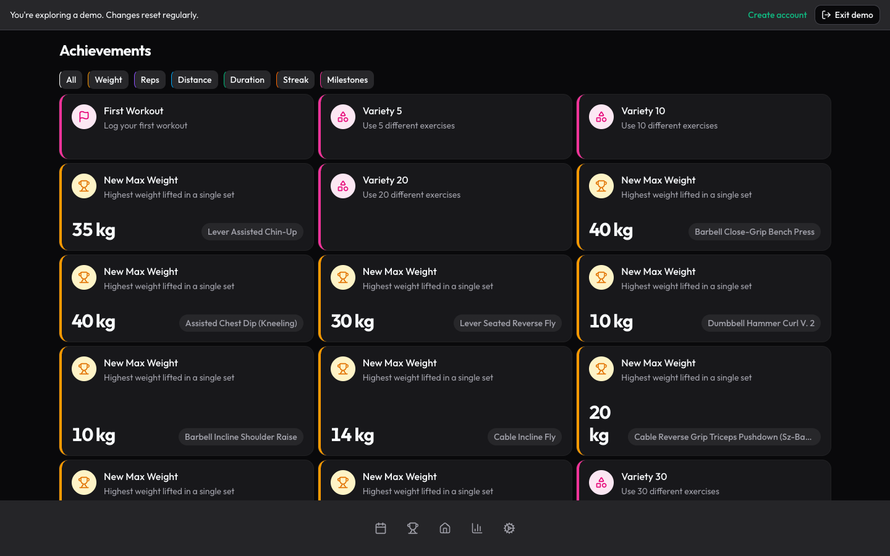
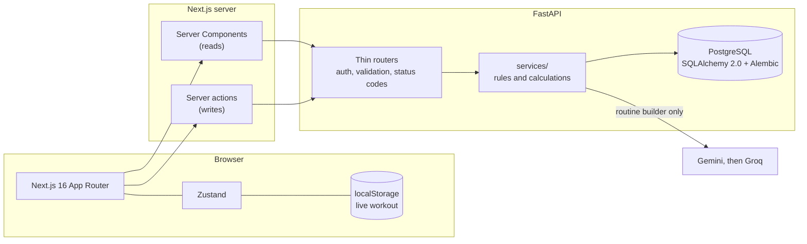

# Gains

Gains is a full-stack fitness tracker built with Next.js 16 and FastAPI. Users build routines, log workouts set by set, and get progression guidance, strength analytics and goal tracking.

The codebase is organised around one rule: calculations live on the server, and anything that can be a deterministic rule is a rule. Only the AI routine builder calls a language model, and its output is validated before it is used.

**[Live demo](https://exercise-tracker-frontend-752853711822.europe-west1.run.app/demo)** · [CI workflow](.github/workflows/ci.yml)



<table>
  <tr>
    <td><br><sub>Routines</sub></td>
    <td><br><sub>Stats</sub></td>
  </tr>
  <tr>
    <td colspan="2"><br><sub>Records and milestones</sub></td>
  </tr>
</table>

Screenshots are from the demo account's sample data.

## What it does

* **Fast live workouts:** warm-ups, drop sets, supersets and rest timers in one workout that survives a page refresh or a dropped signal.
* **Progression suggestions:** the next weight and rep target for each exercise, based on how the last session went.
* **Burnout checker:** spots several lifts stalling, or effort staying very high, and shows the exact numbers behind the suggestion to ease off.
* **Strength and muscle stats:** hard sets per muscle group each week, recovery, and strength compared with body weight.
* **Records and milestones:** personal bests and streaks are kept as a history, plus 14 milestones awarded when a workout is saved.
* **Ready-made programmes and an AI routine builder:** the builder's output is validated and previewed before anything is saved.

<details>
<summary>Full feature list</summary>

### Workout logging
- **Set types:** warm-up, normal, drop and failure. Warm-ups are excluded from volume, muscle breakdown, personal records, e1RM and peak load.
- **Effort tracking:** RPE or RIR per set, shown according to the user's profile preference.
- **Supersets:** grouped in routines and live workouts. The rest timer starts after the last exercise in a round.
- **Rest times:** resolved per exercise in order: the routine item, then the user's exercise setting, then a 180 s default.
- **Units:** kg/lb display toggle. Weights are always stored in kg.
- **Previous values:** last session's numbers for each set, tap to prefill.
- **Reuse:** after finishing, save the workout as a routine, or update or fork the routine it came from, with a diff preview. "Repeat" seeds a new workout from a past one.

### Progression and coaching
- **Double progression:** next-load suggestions per exercise during an active workout.
- **Deload detection:** a global deload fires when 40% of tracked lifts have stalled (no e1RM gain over 4 sessions, or a 5% decline), or when average RPE is 9 or higher over 14 days. The banner can be dismissed for the week.
- **Prebuilt programs:** five programs, applied in one atomic request.
- **AI routine builder:** the model returns JSON, which is validated before anything is saved. Unknown exercise IDs are dropped and sets, reps and rest are clamped. The user reviews a preview, then saves the whole plan in one batch. Limited to 10 requests per hour.
- **Coach personas:** five voices for coaching messages, built from deterministic templates.

### Analytics
- **Overview:** totals with previous-period deltas, switchable between weekly and monthly.
- **Muscles:** weekly hard sets per muscle group against a 10 to 20 set target band, plus a recovery body map. Secondary muscles count as half a set.
- **Strength levels:** best Epley e1RM from the last 180 days, compared with body weight and sex.
- **Consistency** and **Compare** (two exercises or periods over a date range).

### Goals, onboarding and milestones
- **Onboarding:** a five-step flow that sets goal, experience, weekly target, units, sex, body weight and coach. Existing users are redirected once.
- **Goals:** weekly target, body weight and lift progress, shown on the routines page.
- **Milestones:** 14 achievements, awarded once when a workout is saved.

### Body weight, export and sharing
- **Body weight:** one entry per date, upserted by date.
- **CSV export:** workouts and body weight. Cells are sanitised against spreadsheet formula injection.
- **Share cards:** rendered to PNG in the browser and shared with the Web Share API, with a download fallback.

### Carried over
- Routines with a weekly schedule. Start times are stored in UTC and shown in the user's time zone.
- Live workouts that survive a page refresh, and a calendar of past workouts with editing.
- Exercise library with per-exercise history and estimated 1RM over time.
- Optional web push reminders, and a demo account (off by default).

</details>

## Architecture



Writes go through server actions and reads through Server Components or client queries. Server code calls the API with an Axios instance that carries the JWT from an httpOnly cookie. The database is SQLite in development and PostgreSQL in production.

- **Frontend:** feature folders under `src/features/<feature>/` with `actions.ts`, `schema.ts` (Yup, with types inferred from it), `types.ts` and optional store or query modules. Shared UI lives in `src/components/`.
- **Backend:** `routers/`, `services/`, `models/`, `schemas/` and `constants/`. Analytics is a package (`services/analytics/`) with one module per concern: muscles, strength, consistency and compare.
- **Auth:** JWT in an httpOnly cookie, bcrypt password hashing, and a `get_current_user` dependency. Rate limiting uses slowapi, with optional Redis for shared state across instances.

## Decisions

Each decision lists what it buys and what it costs.

**Server-side calculations.** Analytics, progression, deload and milestones run in the backend services, and the frontend renders pre-aggregated JSON.
- *Gain:* one source of truth, and the rules are unit-testable with pytest.
- *Cost:* every new chart or stat needs a backend endpoint first, and the server does work the browser could have done.

**Rules before models.** Progression, deload and persona lines are deterministic and cost nothing to run. Only the routine builder calls an LLM. See [`progression.py`](backend/app/services/progression.py) and [`deload.py`](backend/app/services/deload.py).
- *Gain:* predictable, free, and easy to explain. Each trigger reports the numbers behind it.
- *Cost:* the coaching is only as smart as the thresholds I wrote, and it cannot adapt to an individual the way a learned model could.

**Validate model output, then save atomically.** The builder's JSON is checked before preview. Generated plans and programs are saved with `POST /api/routines/batch`, so a failure leaves nothing half-written. See [`ai_builder.py`](backend/app/services/ai_builder.py).
- *Gain:* a model error can't corrupt the user's routines.
- *Cost:* invalid parts are dropped rather than repaired, so a routine can arrive thinner than the model intended.

**Two model providers.** Gemini is tried first, then Groq. With neither key set, the builder returns 503 and the UI points the user to the prebuilt programs.
- *Gain:* the feature stays available if one provider fails, and the app still boots without keys.
- *Cost:* prompts and validation have to work for both models, and a second adapter has to be maintained.

**Units in one place.** The database stores kilograms. Conversion lives in [`lib/units.ts`](frontend/src/lib/units.ts) and nothing else knows about pounds.
- *Gain:* no rounding drift from repeated conversions, and history stays consistent when a user switches units.
- *Cost:* every screen and input has to go through the converter, so a missed call shows the wrong unit.

**One wide profile table.** `UserProfile` is 1:1 with `User` and created lazily. All the columns that later phases need were added up front.
- *Gain:* no profile migrations as features landed.
- *Cost:* a wide table with many nullable columns, some of which stay empty for users who never use that feature.

**Milestones as a predicate table.** Each milestone is a small predicate over a `WorkoutContext`, kept in [`constants/milestones.py`](backend/app/constants/milestones.py) and [`services/milestones.py`](backend/app/services/milestones.py), outside the larger [`achievement.py`](backend/app/services/achievement.py).
- *Gain:* adding a milestone is one table row and one test.
- *Cost:* milestones are evaluated when a workout is saved, so a new rule only applies to future workouts unless the backfill script is run.

**Personal records as an append-only history.** Each new best or longer streak is saved as its own entry, and the current best per lift is read with a window query. See [`achievement.py`](backend/app/services/achievement.py).
- *Gain:* a workout page can show exactly which records it broke, and a backfill can replay history through the same award functions the live app uses.
- *Cost:* reading the current bests is a slightly heavier query than reading one stored value.

**The live workout is saved on the device first.** Zustand holds the active workout and writes it to local storage on every change. It is sent to the server when the workout is finished.
- *Gain:* a refresh, a crash or a dropped connection in a gym with poor signal never loses a set.
- *Cost:* the workout lives on one device until it is finished, and the rest of the app still needs a connection, so this is not a full offline mode.

**Client-side share images.** `html-to-image` renders the card in the browser, so there is no image service to run.
- *Gain:* simple and cheap.
- *Cost:* output depends on the user's browser and fonts.

**Time zones.** Workout start is `completed_at − duration`, stored in UTC. Local time uses the profile time zone, or UTC if none is set.
- *Gain:* time-of-day features such as early bird and night owl are correct for each user.
- *Cost:* users with no profile time zone get UTC-based results.

**Writes through server actions, reads through queries.** Mutations go through server actions with consistent error handling (`handleApiError`). GETs stay client-side and cacheable.
- *Gain:* one place to handle write errors, and cacheable reads.
- *Cost:* two data-fetching styles in one app to keep consistent.

## Project structure

```text
backend/    FastAPI app (routers, services, models, schemas, constants), Alembic migrations, pytest suite
frontend/   Next.js app (src/app routes, src/features per feature, src/components shared UI)
```

See [AGENTS.md](AGENTS.md) for the coding conventions.

## Running locally

### Backend

```bash
cd backend
python3 -m venv .venv && source .venv/bin/activate
pip install -r requirements-dev.txt
# create backend/.env with the variables below (SECRET_KEY and ALGORITHM are required)
alembic upgrade head
python3 -m uvicorn app.main:app --port 8080
```

### Frontend

```bash
cd frontend
npm install
npm run dev
```

The frontend reads `NEXT_PUBLIC_BASE_URL` (or `BASE_URL`) for the API address. Set it to `http://localhost:8080/api` for local development. If neither is set, it falls back to the deployed backend.

### Upgrading an existing database

```bash
cd backend
alembic upgrade head              # applies the migrations for logging depth and body weight
python backfill_achievements.py   # awards milestones to existing users
```

## Configuration

Backend variables, read from the environment or `backend/.env`:

| Variable | Required | Purpose |
| :--- | :--- | :--- |
| `SECRET_KEY` | yes | JWT signing key, at least 32 characters |
| `ALGORITHM` | yes | `HS256`, `HS384` or `HS512` |
| `DATABASE_URL` | no | Defaults to a local SQLite file |
| `DB_CA_CERT_PATH` | no | CA certificate for PostgreSQL connections |
| `FRONTEND_ORIGIN` | no | Allowed CORS origin, defaults to `http://localhost:3000` |
| `DEMO_MODE_ENABLED` | no | `true` enables `POST /api/auth/demo` |
| `TRUSTED_PROXY_COUNT` | no | Turns on per-IP rate limiting for the auth routes. Set it to the number of proxies in front of the API |
| `REDIS_URL` | no | Shared rate-limit storage across instances, in-memory otherwise |
| `VAPID_PRIVATE_KEY` | no | Needed to send push reminders |
| `GEMINI_API_KEY` | no | AI routine builder, primary provider |
| `GEMINI_MODEL` | no | Defaults to `gemini-3.5-flash` |
| `GROQ_API_KEY` | no | AI routine builder, fallback provider |
| `GROQ_MODEL` | no | Defaults to `openai/gpt-oss-20b` |

Everything except the AI builder works without the model keys.

Frontend variables: `NEXT_PUBLIC_BASE_URL`, `BASE_URL`, `NEXT_PUBLIC_POSTHOG_PROJECT_TOKEN`, `NEXT_PUBLIC_POSTHOG_HOST`.

Never commit `.env` files.

## Testing and quality

* **Backend:** more than 200 pytest tests across rules, services and routers, including the not-enough-data and cooldown cases for coaching.
* **Frontend:** about 300 Vitest tests and 21 Playwright browser tests that run against an isolated real backend.
* **CI:** [GitHub Actions](.github/workflows/ci.yml) runs pytest, then lint, Vitest and a build, then the Playwright tests, plus an advisory dependency audit, on every pull request.
* **Migrations:** 18 Alembic migrations.
* **Security:** JWT in an httpOnly cookie, bcrypt password hashing, sign-in and registration rate limits that read the client address safely behind a proxy, and CSV export that is sanitised against spreadsheet formula injection.

```bash
cd backend && python -m pytest
cd frontend && npm run lint && npm test && npm run build
cd frontend && npx playwright test
```

The read-only public demo account is described in [`docs/specs/public-demo-mode.md`](docs/specs/public-demo-mode.md).

## Known limitations

* **Not a full offline mode.** The live workout survives a dropped signal, but the rest of the app needs a connection.
* **Backfilled milestones carry the backfill date.** The catch-up script awards past milestones with the day it ran, not the original workout date.
* **Lift goals and routine weight targets are unfinished.**
* **Migrations cannot build an empty database.** The Alembic history assumes tables that were created before it started, so a fresh local database is set up from the models and then marked as up to date. Existing databases migrate normally.
* **Only my own use as evidence.** I have used Gains for several months, but I have no performance benchmarks or other users' metrics.

## Reminders

The reminder job sends a push notification for routines starting within the next hour. Run it from `backend/` on a schedule, for example every hour:

```bash
python3 -m app.run_reminder
```

## API

The backend serves interactive docs at `/docs` while it is running.
